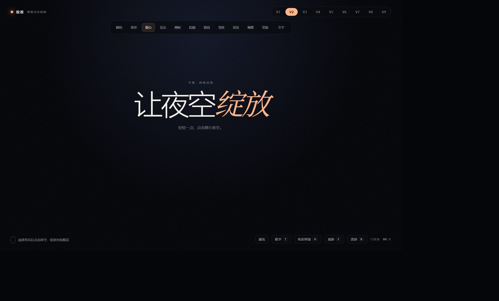
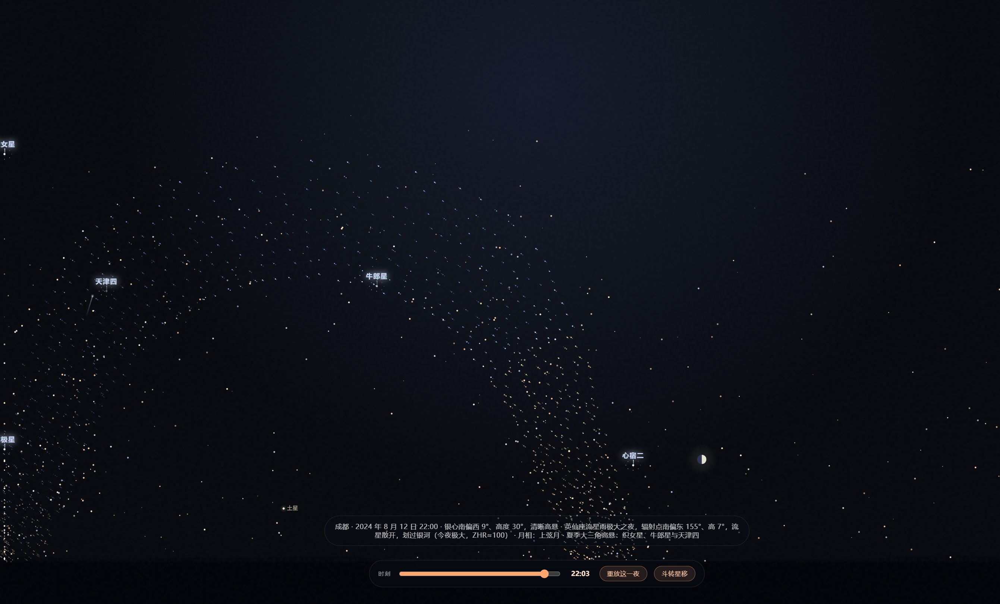

# 绽夜

在浏览器里一起放烟花的夜空。可以选形态、发弹幕、编辑作品，也可以用一句话生成烟花，或按日期和城市还原当晚的银河。





## 我做了什么

这是一个在本地就能跑起来的 Web 产品。打开浏览器可以自己放烟花，也可以和别人待在同一片夜空里。

我独立完成了产品设计和实现，并按九个版本往前加能力：

- **单人烟花：** 点击绽放，再选择形态和文字。
- **多人夜空：** 实时同步、近距离合并、密码房间、公共大厅和弹幕。
- **创作：** 自己编辑作品并分享到私人房间；也可以用一句话生成烟花。
- **天文场景：** 选择日期和城市，在本地还原那一晚的银河。

九个版本同时留在页面顶栏，可以从 V1 切到 V9。后一个版本保留前面已经有的功能。每一版的细则见 [docs/版本说明.md](docs/版本说明.md)。

## 主要功能

| 版本 | 能做什么 |
|---|---|
| V1 点击绽放 | 打开页面，点击夜空放烟花 |
| V2 形态与文字 | 选择星形、爱心、花朵等形态，或输入文字，按字形绽放 |
| V3 多人同步 | 填写昵称并连接，同一服务器上的人能看到彼此的烟花 |
| V4 近距离合并 | 两位玩家在 5 秒内、相距不超过 60 像素各点一次，会额外绽放一朵大型合并烟花 |
| V5 密码房间 | 房主自设 4–12 位密码，得到 6 位房间号。烟花和在线名单只在同一房间内同步 |
| V6 公共大厅 | 进入大厅发送弹幕。每人 5 秒最多 5 条，每条最多 80 字。私人房间仍然可用 |
| V7 烟花作品 | 编辑形状、文字、颜色、大小和速度，保存在当前浏览器（最多 30 个），并分享到私人房间 |
| V8 一句话生成 | 用自然语言生成烟花、文字和房间主题。需要自己的模型密钥，密钥只放在服务端 |
| V9 那一夜的银河 | 选择日期、时刻和城市，在本地还原当晚银河、月相和流星雨。不联网，也不用模型密钥 |

文字烟花在 V2–V7 最多 6 个字，从 V8 起最多 10 个字。房间数据保存在服务器内存里，重启后会清空。

## 三分钟上手

需要先安装 [Node.js](https://nodejs.org/) 18 或更新版本。在项目目录打开终端：

```powershell
npm install
npm start
```

浏览器打开 <http://localhost:3000>。保持终端窗口运行，按 `Ctrl+C` 停止服务器。

建议按这个顺序点一遍：

1. **先放一朵。** 第一次打开是 V1，在夜空任意位置点一下。如果浏览器记得上次的版本，点顶栏 **V1**。
2. **换一种形态。** 顶栏点 **V2**，选择「爱心」，或点「文字」输入几个字，再点夜空。
3. **进大厅。** 顶栏点 **V6**。昵称可以保持默认，点「进入公共大厅」，发一条弹幕，再点夜空。同一台电脑再开一个窗口，同样进入公共大厅，两边能看到对方的烟花和弹幕。
4. **看一晚银河。** 顶栏点 **V9**。日期默认是今天，时刻是 22:00，城市默认成都，直接点「绽放那一夜的银河」。想看更完整的银河，点「天象录」，选一个推荐日期。这一步不需要配置密钥。

想看每一版在解决什么问题，点右下角「教学」，或按 `T` 键。

### 和朋友一起玩

同一局域网里的手机或电脑，用运行服务器那台电脑的地址访问，例如 `http://192.168.1.20:3000`。V3、V4 填写昵称后点「连接夜空」；V6 及之后点「进入公共大厅」，或填写房间号和密码加入私人房间。

不同网络的朋友要一起玩，需要把服务放到可公开访问的主机上，并用 HTTPS / WSS 打开。不要把没有保护的服务器直接暴露到公网。

## 可选：一句话生成烟花

V8 的「生成烟花作品」「生成烟花文字」「生成房间主题」会把你的描述发给 `.env` 里配置的模型。不配置密钥，V1–V7 和 V9 都可以正常使用。

把 `.env.example` 复制为 `.env`，填入自己的密钥，保存后重新运行 `npm start`。

使用 OpenAI：

```env
AI_API_KEY=你的模型服务密钥
AI_BASE_URL=https://api.openai.com/v1
AI_MODEL=gpt-4o-mini
```

使用 DeepSeek：

```env
AI_PROVIDER=deepseek
DEEPSEEK_API_KEY=你的DeepSeek密钥
DEEPSEEK_BASE_URL=https://api.deepseek.com
DEEPSEEK_MODEL=deepseek-flash
```

密钥只由 Node.js 服务端读取，网页接触不到。每个来源地址每分钟最多请求 8 次。房间主题只有私人房间的房主可以设置。

## 技术栈

页面是单页，烟花和星空用 Canvas 绘制。Node.js 负责提供页面、WebSocket 房间，以及把生成请求转发给模型。运行依赖只有 `ws`。

## 目录

| 文件 | 内容 |
|---|---|
| `index.html` | 当前主页面，九个版本都在这里切换 |
| `server.js` | 静态页面、房间、弹幕、作品同步和模型代理 |
| `presets.js` | 烟花配方 |
| `.env.example` | 模型配置模板，复制成 `.env` 后填写 |
| `通信可视化.html` | 烟花通信监控页。主页面右下角「通讯」会打开它 |
| `docs/版本说明.md` | 各版本的功能细则 |
